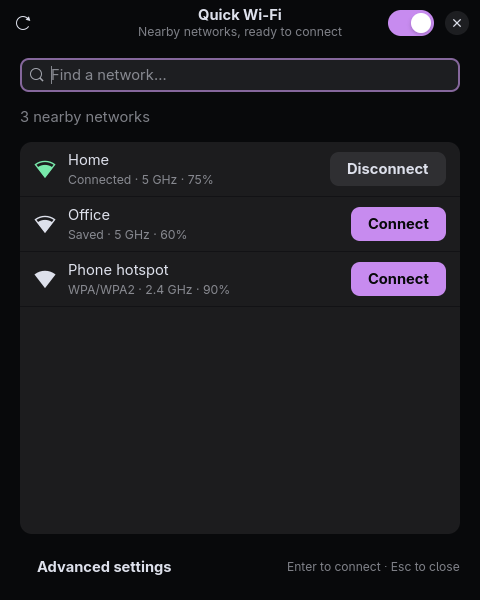

# Quick Wi-Fi

A small Wi-Fi connection picker for **Omarchy**, built with GTK4, libadwaita, and
NetworkManager's libnm API. See nearby networks immediately, refresh in the
background, and connect to saved networks with one click.



*Demo screenshot with sample network names.*

## Features

- Shows cached access points immediately while requesting a fresh scan.
- Updates networks and connection status from NetworkManager events.
- Reuses saved profiles without an extra scan or an explicit disconnect first.
- Supports new open, WPA/WPA2 Personal, WPA3 Personal, and Enhanced Open connections.
- Preserves password entry while results change, with retry after connection failure.
- Groups access points by SSID, security, and adapter, preferring the active AP.
- Includes search, refresh, radio control, and connection cancellation.
- Follows the active Omarchy color palette in a compact floating window.
- Provides a Quickshell bar launcher and **Meta+N** integration with config backups.

The Wi-Fi window is a **separate GTK application**. Quickshell supplies only the
bar widget. Networking goes through libnm over D-Bus, outside Quickshell's scanner.

## Requirements

- Arch Linux with Python 3.11+, PyGObject, GTK4, libadwaita 1.5+, and libnm.
- A working NetworkManager-managed Wi-Fi adapter and graphical desktop session.
- Omarchy Quattro with `shell.json`, the plugin CLI, and Lua Hyprland configuration
  for optional bar/shortcut integration.
- `nm-connection-editor` for the optional **Advanced settings** button.

Integration was tested on Omarchy 4.0.6. Other versions may change configuration
interfaces. On other desktops, run the GTK app from the checkout; the installer
currently expects Omarchy.

## Install

Install missing dependencies through Arch's normal full-upgrade workflow:

```bash
sudo pacman -Syu --needed python python-gobject gtk4 libadwaita libnm networkmanager nm-connection-editor
```

NetworkManager should already manage your adapter. Quick Wi-Fi does not switch
networking services.

```bash
git clone https://github.com/akashanil-dev/quickwifi.git
cd quickwifi
python install.py
```

Open **Quick Wi-Fi** from your launcher or run `~/.local/bin/quick-wifi`.
To try it without installing, run `./quick-wifi` from the checkout.

### Omarchy integration

```bash
python install.py --integrate
hyprctl reload
hyprctl configerrors
```

This replaces the Wi-Fi bar entry, assigns **Meta+N**, disables the old
**Super+Ctrl+W** network shortcut, and adds a floating-window rule. Meta is the
Super/Windows key. Integration reassigns Meta+N if it was already in use.

The installer backs up `shell.json` and `bindings.lua`, preserves unrelated
configuration, and never edits packaged Omarchy files. Existing shell summons of
`omarchy.network` route to the replacement. If the bar retains a cached widget,
run `omarchy restart shell`.

### Update

```bash
git pull --ff-only
python install.py
```

Reinstalling without `--integrate` updates app/plugin files without rewriting the
shortcut or bar configuration. Close and reopen the app to use updated code.

### Restore the default panel

From the checkout:

```bash
python install.py --restore
hyprctl reload
hyprctl configerrors
```

Restore swaps the bar entry back and removes only Quick Wi-Fi's marked shortcut
and window-rule block. Other configuration changes are preserved. The GTK app
remains available separately.

### Installation locations

| Item | Location |
| --- | --- |
| Application | `~/.local/share/quickwifi/` |
| Launcher | `~/.local/bin/quick-wifi` |
| Desktop entry | `~/.local/share/applications/io.github.akashanil_dev.quickwifi.desktop` |
| Bar widget | `~/.config/omarchy/plugins/akash.quickwifi/` |

To uninstall, restore the default panel, close Quick Wi-Fi, then remove these four
application-owned locations. Saved NetworkManager connections are not removed.

## Controls

| Control | Action |
| --- | --- |
| Meta+N | Open Quick Wi-Fi after integration |
| Search + Enter | Connect to the first matching disconnected network |
| Ctrl+F | Focus search |
| Ctrl+R | Request a fresh scan |
| Escape | Dismiss the password prompt or close the window |
| Connect / Disconnect | Act on that network |
| Cancel | Cancel activation once NetworkManager accepts the request |
| Wi-Fi switch | Turn the Wi-Fi radio on or off |
| Advanced settings | Open `nm-connection-editor` |

Closing during a connection attempt hides the window while the request continues.
Reopening presents the same instance. A normal close otherwise exits.

## How it stays responsive

Quick Wi-Fi renders cached results before requesting a scan. AP events and
`LastScan` updates drive the list, rather than a fixed scan-completion timer.
Opening/refocusing or pressing Refresh requests scanning directly. Automatic
refresh runs every 15 seconds while focused, except during password entry or
a connection attempt.

The Quickshell version that motivated this project applies a 10,001 ms scan
interval. Quick Wi-Fi avoids that extra frontend gate. **NetworkManager, the
driver, and the radio still control scan availability and duration.** Faster
discovery does not guarantee faster authentication or DHCP.

See [implementation and source notes](docs/design.md) for the comparison with
Omarchy's default panel and Adw Network.

## Scope and troubleshooting

- **Enterprise, legacy, and hidden networks:** configure them in Advanced settings.
  Compatible saved profiles for visible networks can then be activated here.
- **Hotspot creation, VPN, Ethernet:** use the relevant system tools.
- **No networks:** check NetworkManager management, radio state, and hardware blocking.
- **Scan deferred:** NetworkManager may reject a scan temporarily. Existing results
  remain usable; wait briefly and press Refresh.
- **Wrong saved password:** reconnect after failure to enter a replacement password
  for a personal network. Use Advanced settings for other profile types.
- **Permission error:** the app uses normal NetworkManager/Polkit permissions.
  Run it as your desktop user, not as root.

Passwords go through libnm, never command-line arguments or application files.
NetworkManager stores new profiles with current-user permission. Existing profiles
retain their settings and permissions when reused; password retry updates the
existing personal-network profile.

## Development and tests

Use system Python/GI packages; no pip dependencies are needed.

```bash
python -m unittest discover -s tests -v
python tests/ui_smoke.py
```

Unit tests cover network selection, real libnm profile validation, and mocked
scan/activation events. The GUI test uses real GTK widgets and a fake backend.

A live smoke test requests a scan but never connects, disconnects, or changes the
radio. Close other Quick Wi-Fi instances first:

```bash
mkdir -p artifacts
./quick-wifi --smoke-test --report artifacts/live-smoke.json --snapshot artifacts/quick-wifi.png
```

Reports omit network names and passwords. **Live screenshots show nearby network
names.** `artifacts/` is ignored by Git. Passing mocked tests or scan tests does
not establish successful authentication on every Wi-Fi setup.

See [CONTRIBUTING.md](CONTRIBUTING.md) for contribution guidance.

## License and acknowledgements

[MIT](LICENSE). Built on GTK, libadwaita, NetworkManager/libnm, and Omarchy's plugin
interfaces. [Adw Network](https://github.com/PlayRood32/adw-network) inspired the
focus on responsive scanning. This is an independent project, not an official
Omarchy component.
